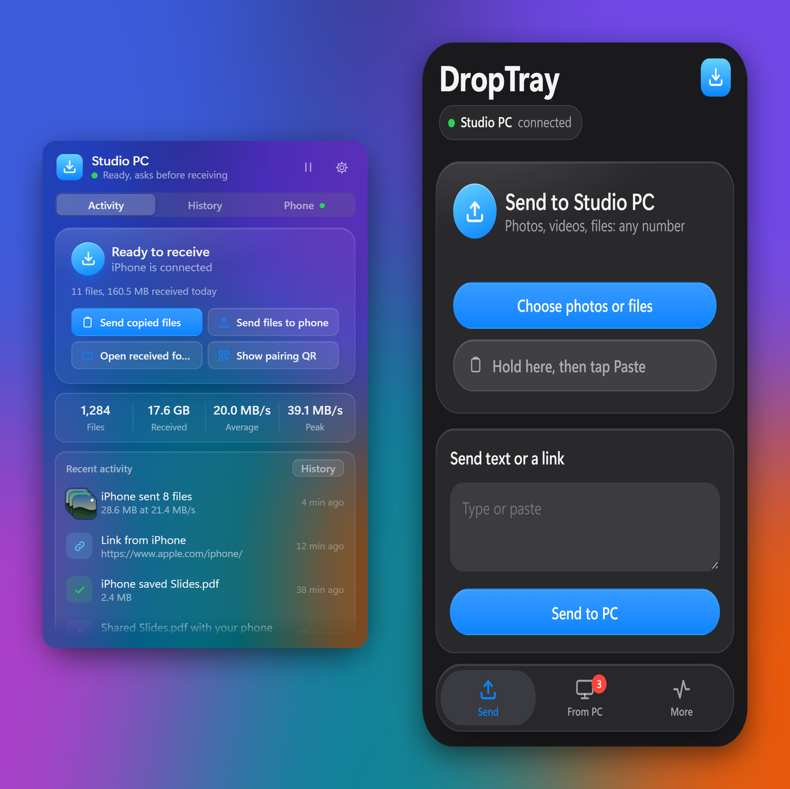
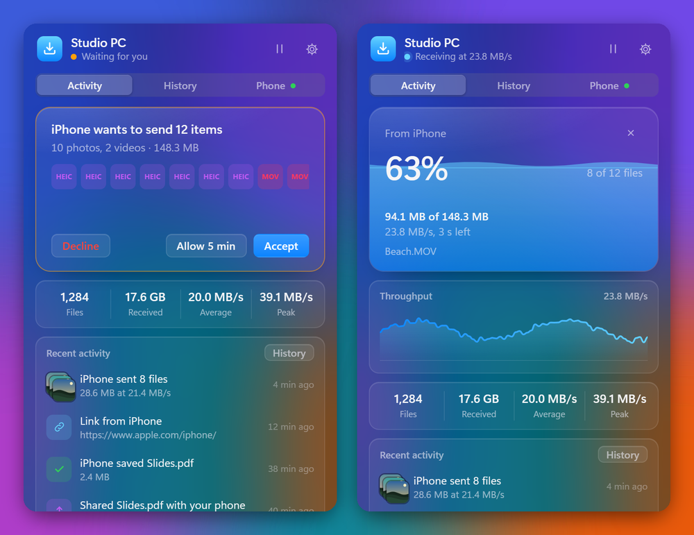
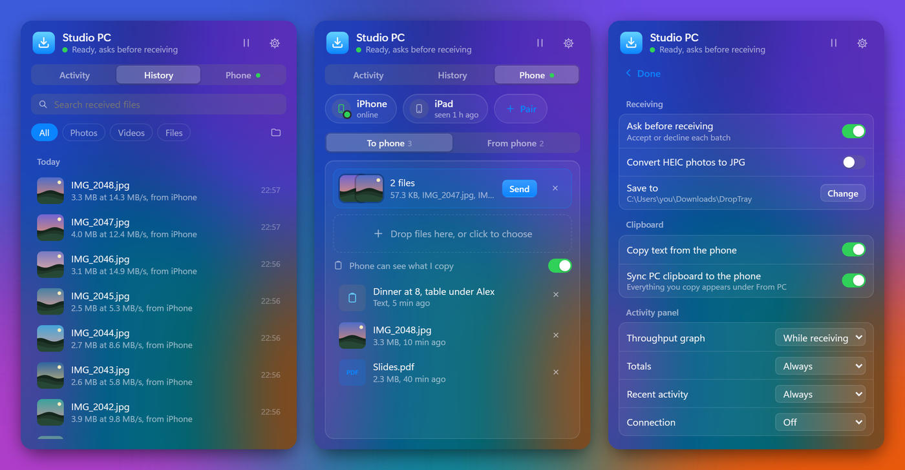
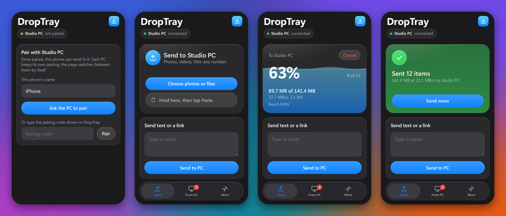
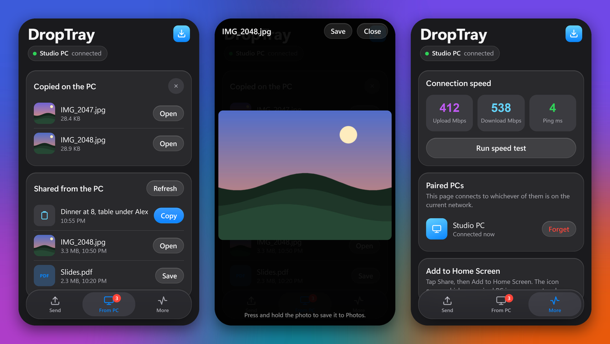
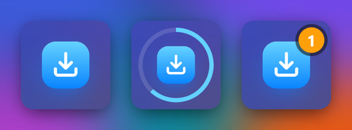
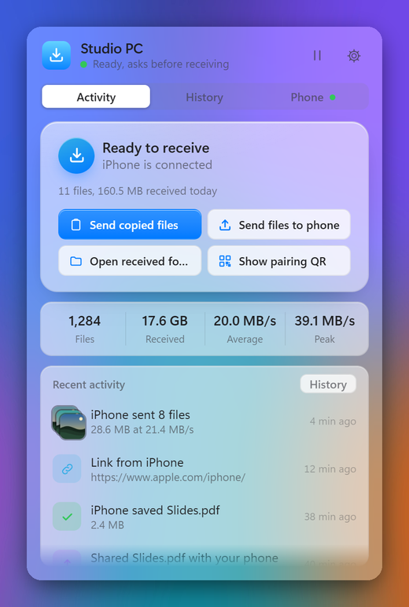

# DropTray

**Send photos, videos, files, text and your clipboard between an iPhone and a Windows PC, over your own network.**
A tray app with a glass drawer on Windows 11, and a web page on the iPhone, so there is nothing to install on the phone.



DropTray is not AirDrop: Windows can't speak Apple's AirDrop radio protocol. Instead, the iPhone opens DropTray's
page (one tap from the Home Screen) and sends over Wi-Fi to the PC, which asks you before anything arrives.
Files go straight from the phone to the PC on your network, with no cloud, account or upload limit.

- [Install](#install)
- [Updates](#updates)
- [Get started](#get-started)
- [What it does](#what-it-does)
- [Privacy and security](#privacy-and-security)
- [Limitations](#limitations)
- [For developers](#for-developers)

## Install

Windows 11, 64-bit. Pick one:

| How | Command or link |
|---|---|
| **Installer** | Download [**DropTraySetup.exe**](https://github.com/TechnoQuantum/droptray/releases/latest/download/DropTraySetup.exe) and run it |
| **PowerShell, no wizard** | `irm https://raw.githubusercontent.com/TechnoQuantum/droptray/main/install.ps1 \| iex` |
| **curl** | `curl -LO https://github.com/TechnoQuantum/droptray/releases/latest/download/DropTraySetup.exe` |
| **winget** | `winget install TechnoQuantum.DropTray` (once accepted into the winget catalog; see [packaging/winget](packaging/winget)) |
| **Portable zip** | [DropTray-win-x64.zip](https://github.com/TechnoQuantum/droptray/releases/latest/download/DropTray-win-x64.zip): unzip anywhere, run `DropTray.exe` |

All of them install for your user only, with no administrator prompt, into `%LOCALAPPDATA%\Programs\DropTray`.
The PowerShell script checks the download against the release's `SHA256SUMS.txt` before installing.

**Uninstall:** Settings → Apps → DropTray, or
`& ([scriptblock]::Create((irm https://raw.githubusercontent.com/TechnoQuantum/droptray/main/install.ps1))) -Uninstall`.
Your settings and history stay in `%APPDATA%\DropTray`.

## Updates

DropTray updates itself. A little after it starts, and every 6 hours after that, it asks GitHub for the latest release.
When there's a newer one, it:
1. downloads it in the background and checks it against the release's `SHA256SUMS.txt`;
2. waits until nothing is transferring and no request is waiting;
3. installs it silently, then restarts.

The next start shows *Updated to x.y.z* as a notification and in Recent activity. Settings → **Updates** shows your version, has **Check now** and **Install now**, and an
**Update automatically** switch. The tray menu has *Check for updates*.

It updates the way you installed: Setup.exe installs update with the new Setup.exe, and zip or script installs update from the new zip.
To update by hand, run the installer or the PowerShell line again; both install over the old version and keep your settings.

## Get started

1. **Let the phone in.** Windows Firewall blocks incoming connections by default. Tick *Let phones on my home
   network reach DropTray* in the installer, or run the script with `-Firewall`. That opens TCP 8765 and UDP 5353,
   on private networks only.
2. **Pair your iPhone.** Click the tray icon, then **Show pairing QR**, and scan it with the iPhone camera. Safari
   opens DropTray's page and pairs.
3. **Add it to the Home Screen.** In Safari: Share → Add to Home Screen. The icon points at `droptray.local`, so it
   finds whichever paired PC is on your current network, at home or at work.
4. **Send something.** Tap *Choose photos or files*. The PC asks you to accept, and the files land in
   `Downloads\DropTray`.

## What it does

### Accept, then watch it arrive

Every batch asks first, as a Windows notification and in the drawer, even while DropTray is closed:
**Accept**, **Allow 5 min** (accept everything for five minutes) or **Decline**. A transfer fills the drawer's glass card
like liquid, with the percentage, file count, speed, time left, the current file and a button to stop the rest.



### Activity

The **Activity** tab is the drawer's home. It shows whether you're ready to receive, which phones are connected, what
arrived today, and quick actions:

- **Send copied file / text / image:** sends whatever is on the PC clipboard to the phone.
- **Send files to phone:** pick files to share.
- **Open received folder.**
- **Show pairing QR.**

Below it, **Recent activity** tells the story: what your phone sent, links and text it sent, what you shared and
when the phone saved it, new pairings and declined requests. Click an entry to open the file or link.

Each block (throughput graph, totals, recent activity, connection details) can be set to *Always*, *While receiving*,
*When idle* or *Off* in Settings, so the drawer shows only what you care about, without scrolling.

### History, Phone and Settings



- **History:** every file received, with photo thumbnails, search and filters for photos, videos and files. Click to
  open; the folder button shows it in Explorer. Right-click to copy the path, send it back to the phone, or move it to
  the Recycle Bin. The list stays smooth with thousands of entries.
- **Phone:**
  - **Paired devices** show at the top, with a green dot when online. Click one to unpair it.
  - **To phone:** what you copied on the PC appears as a card with **Send** and × (dismiss). Drop files onto the drawer,
    or click to choose, to share them; they appear on the phone under *From PC*.
  - **From phone:** text and links the phone sent, with copy and open buttons.
- **Settings:**
  - Ask before receiving, HEIC to JPG conversion, and the save folder.
  - Clipboard options, and which Activity blocks show.
  - This PC's name and pairing code.
  - Open at sign-in, stay open when clicking elsewhere, the desktop widget, and where the drawer opens.
  - **Window glass:** *Frosted*, *Clear* or *Mica*.

### The clipboard, both ways

- **PC → iPhone:** turn on *Phone can see what I copy*, and whatever you copy on the PC (text, files in Explorer, a
  screenshot) shows up on the phone under *From PC* with Copy, Open or Save. It's off until you turn it on.
- **iPhone → PC:** on the phone, hold the Paste field and tap Paste. Photos, files and text all work; text lands on the
  PC clipboard. For a hands-free version, the [iOS Shortcuts guide](SHORTCUT.md) sets up *Copy to PC* and
  *Paste from PC* on Back Tap.

### Several phones, several PCs

Each phone gets its own key when it pairs, and you can unpair any of them. Each PC announces itself as
`droptray.local` over Bonjour. One Home Screen icon reaches the home PC at home and the work PC at work, and the page
picks the right key by itself. A new PC pairs with one tap on the phone and one click on the PC, with no code needed.

### On the iPhone




- **Send:** any number of photos, videos and files, two at a time. Watch the progress, cancel, or send text and links.
- **From PC:** the PC's clipboard (if you allow it) and the files it shared. Photos and videos open in a viewer inside
  the page; other files open in their own window, so you never get stuck.
- **More:** a Wi-Fi speed test (the result also shows on the PC), your paired PCs, and the Home Screen tip.

### The desktop widget



An optional round glass widget for the desktop: Settings → *Desktop widget*. It sits beneath every window, so you
only see it on the desktop and never over an app or a game. Its ring shows what's happening: **green** while receiving
(filling with progress, then a full green flash when done), **blue** while the phone downloads something you shared,
a **yellow half ring** when the clipboard syncs, **red** when a transfer fails, and an **orange** badge counting requests
waiting for you. Drag it anywhere; click it to open the drawer. Set *Open the drawer* to *Next to the widget* to have
the drawer appear beside it.

### Light mode and glass

DropTray follows Windows' light or dark mode. The drawer sits on Windows 11's own Acrylic, so your desktop shows
through, frosted. Choose *Clear* for more see-through, or *Mica* for a calmer wallpaper tint.



## iPhone app (beta)

A native SwiftUI app with a Share-sheet extension lives in [`ios/`](ios). It offers one-tap Paste (videos too),
Bonjour discovery, QR pairing and Liquid Glass. Build it yourself with Xcode: see [ios/README.md](ios/README.md).

## Privacy and security

- **Local only.** Nothing leaves your network. There's no account, server or telemetry.
- **Pairing.** Phones need a pairing key, issued only when you accept the request on the PC or type its code. Unpair
  any phone at any time.
- **You decide.** Every incoming batch asks first, unless you turn that off.
- **Clipboard sharing is off by default.** A paired phone sees the PC clipboard only after you allow it.
- **Firewall.** The optional rules open DropTray's ports on private networks only, never on public Wi-Fi.
- **Encryption.** The iPhone app uses HTTPS, pinned to the PC's own certificate (no warnings, nothing to install).
  The browser page uses plain HTTP: on shared or work Wi-Fi, prefer the app.

## Limitations

- **Not AirDrop.** The iPhone sends from DropTray's page or a Shortcut, not the AirDrop sheet. Native AirDrop on a PC
  needs Linux and specific Wi-Fi hardware (see [omdrop](https://github.com/brentkearney/omdrop-plugin)).
- **One-tap Paste.** Safari lets a web page read the clipboard only over HTTPS, so pasting takes a hold and a tap.
  Pasting videos isn't possible from a web page; use *Choose photos or files*.
- **Bonjour on office networks.** Some networks block Bonjour (the page falls back to the PC's IP address) or stop
  devices from seeing each other. In the second case no local app can connect.
- **Windows 11 only.** The glass relies on Windows 11's Acrylic.

## For developers

```powershell
git clone https://github.com/TechnoQuantum/droptray; cd droptray
py -3.11 -m venv .venv
.venv\Scripts\pip install pywebview pystray Pillow pillow-heif windows-toasts qrcode zeroconf pyinstaller
.venv\Scripts\python.exe droptray.py --show                          # run from source
.venv\Scripts\python.exe tests\test_multipart.py; .venv\Scripts\python.exe tests\test_store.py
.venv\Scripts\python.exe -m PyInstaller DropTray.spec --noconfirm    # -> dist\DropTray\DropTray.exe
& "$env:LOCALAPPDATA\Programs\Inno Setup 6\ISCC.exe" installer\DropTray.iss   # -> installer\Output\DropTraySetup.exe
```

| Path | What |
|---|---|
| `droptray.py` | Entry point (a second launch opens the running copy's drawer) |
| `core.py` | HTTP server, pairing, accept prompts, transfers, history, activity log, Bonjour, notifications |
| `ui.py` | Tray icon, glass windows (drawer, widget), and the bridge their pages call |
| `web/drawer.html`, `web/widget.html` | The drawer and the widget |
| `web/index.html` | The iPhone page |
| `API.md` | The HTTP API: everything the iPhone page does, for a native iOS app later |
| `updater.py` | Self-update from GitHub Releases: check, download, verify, install when idle, restart |
| `installer/DropTray.iss`, `install.ps1` | Inno Setup installer, and the no-wizard install script |
| `release.ps1` | One command to build and publish a release (`-Publish`); the version is `APP_VERSION` in `core.py` |
| `packaging/winget` | winget manifests |
| `SHORTCUT.md` | iOS Shortcuts: *Send to PC* in the Share sheet, and clipboard on Back Tap |

Data lives in `%APPDATA%\DropTray`:
- `config.json`: settings and paired devices
- `history.json`: transfers and activity
- `droptray.log`
- thumbnails

## License

[MIT](LICENSE)
